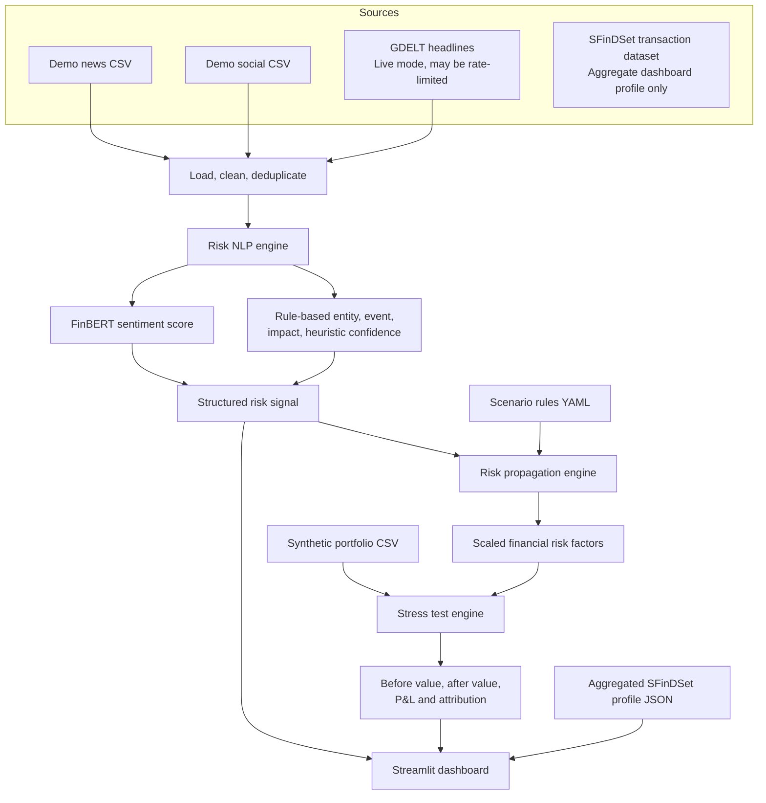

# RiskPulse AI Architecture

## Data boundary

SFinDSet is used for aggregate transaction counts and date-range context in the dashboard. Its transaction amounts are not treated as portfolio holdings. The portfolio in `data/portfolio.csv` is synthetic.